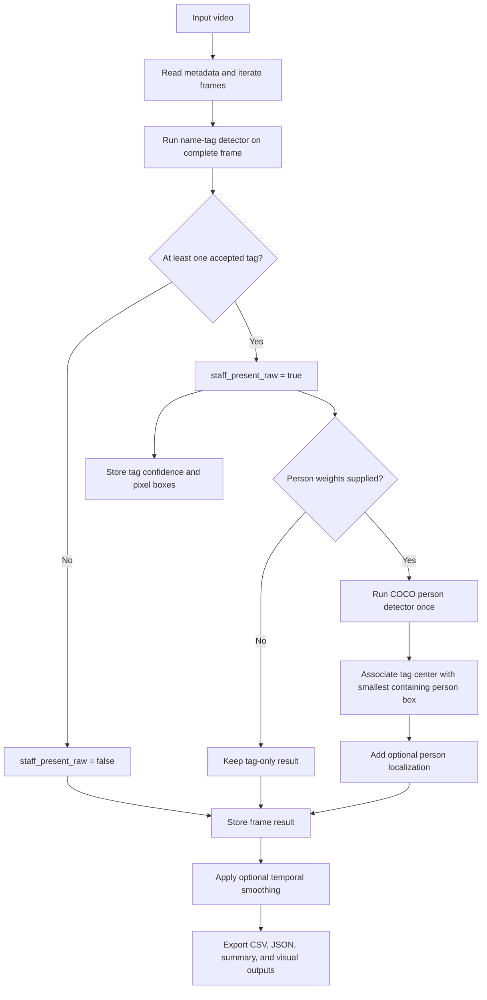

# FootfallCam Staff Presence Detection

## 1. Solution overview

The objective is to identify video frames in which a staff member is present. In this
solution, staff presence is defined as the visibility of at least one `name_tag`.
The system does not read the name, identify the person, or recognize the person from
their appearance.

Two approaches were considered:

- **Person-first:** detect people first, crop each person region, and search for a
	name tag within each crop.
- **Tag-first:** detect name tags directly across the complete video frame.

The selected solution is **tag-first** (For the justification, kindly look for appendix).

The current implementation uses a two-stage, tag-first architecture. The primary
stage runs the trained `name_tag` detector on the complete frame and makes the staff
presence decision from its accepted detections. It then records the frame metadata,
confidence values, and pixel-coordinate boxes. An optional second stage runs a
pretrained person detector only when the primary stage finds a tag, and associates
each tag with the smallest person box containing its center. Both stages are followed
by structured result export and visualization; optional temporal smoothing is applied
after raw frame-level predictions have been recorded. The person stage enriches the
location output but cannot override the tag-based presence decision.

The architecture can be summarized as follows:



The main architectural boundary is the tag detector. A frame becomes staff-positive
when `classify_staff_presence()` receives one or more accepted tag detections. The
optional person detector is downstream enrichment rather than a prerequisite: it is
skipped on tag-negative frames, runs at most once for a positive frame, and cannot
turn a positive tag result into a negative result if no person box is matched.

## 2. Data

The source video contains 1,341 frames at 25 FPS, with a resolution of 960 x 720
pixels and a duration of approximately 53.64 seconds.

## 3. Name-tag model training

For training, every fifth frame was extracted, producing 269 sampled images. The
images were annotated using a one-class YOLO dataset containing the class `name_tag`.
The sampled frames were split chronologically into 188 training images, 40 validation
images, and 41 test images.

This temporal split preserves the sequence of the original video, but neighboring
frames can appear in different subsets. Therefore, validation and test performance
may be more optimistic than performance on a completely different recording.

The trained model is an Ultralytics YOLO detector using the saved weights at
`frames_25fps_every_5/runs/name_tag_detection/weights/best.pt`. The training workflow
used YOLO11n with a 960-pixel image size, 100 epochs, automatic batch sizing, GPU
training, two workers, five-degree rotation, horizontal flipping, and early stopping
patience of 20 epochs. The local Jupyter kernel crashed during training, so after
processing and preparing the data, the training step was completed in Google Colab.
The training and evaluation code is available in
[name_tag_detector_training.ipynb](name_tag_detector_training.ipynb). During
inference, a confidence threshold of `0.25` is used by default.

## 4. Inference workflow

The inference workflow is implemented in [predict.py](predict.py). Unlike the
training data, which uses every fifth frame, the final inference process reads every
frame in the video.

Although these logical modules currently live in one script, they are separated by
responsibility and communicate through small, explicit data structures. 

The modules have the following responsibilities and contracts:

- `read_video_metadata()` validates the video and records FPS, frame count,
	resolution, and duration.
- `iter_video_frames()` yields each decoded frame with its original frame number and
	timestamp. Frames are not renumbered after extraction.
- `load_detector()` checks that the requested weights exist before loading the
	Ultralytics model.
- `detect_name_tag()` runs the task-specific detector and converts model coordinates
	into integer pixel boxes.
- `classify_staff_presence()` makes the primary Boolean decision from the accepted
	tag detections.
- `detect_people()` is used only by the optional hybrid stage and filters the
	pretrained model to COCO class `0`.
- `build_tag_associations()` applies tag-center containment and records matched or
	unmatched person associations without changing tag presence.
- `smooth_temporal_predictions()` optionally fills short raw-negative gaps between
	positive detections.
- `write_results()` and `render_visualization()` produce the structured files and
	annotated visual evidence.

The input and frame module owns video I/O and timeline integrity. It does not make
model decisions. The tag detection module owns only model inference and coordinate
conversion, returning zero or more `Detection` records containing confidence, pixel
box, and class ID. The presence decision module consumes those records and returns a
Boolean result, keeping the main business rule independent from Ultralytics details.

The optional person-localization module is deliberately downstream of that decision.
It receives the original frame only for tag-positive cases, returns person detections,
and passes them to the association module. The association module calculates each
tag center, checks inclusive containment, and selects the smallest containing person
box, using confidence to break equal-area ties. This produces additional localization
metadata without changing the primary presence result.

Finally, the post-processing and output module receives complete `FrameResult`
records. It applies optional temporal smoothing after raw predictions exist, then
writes CSV, JSON, summary, and visualization outputs. This ordering preserves the
difference between what the detector observed and what optional post-processing adds.

For each frame, the pipeline preserves the original zero-based frame number,
calculates the timestamp using `frame_number / fps`, runs the name-tag detector on
the complete frame, and classifies the frame as staff-present when at least one
accepted tag detection exists. Detected boxes are converted into pixel coordinates,
and confidence values and all accepted detections are stored.

Raw predictions are retained separately from optional smoothed predictions. Temporal
smoothing is disabled by default. It can be enabled to fill short gaps between
positive detections, but only when positive detections exist immediately before and
after the gap.

An optional hybrid stage can provide full-person localization. When person weights
are supplied, a pretrained COCO person detector runs only on tag-positive frames.
Each tag is associated with the smallest person box containing its center. A missing
person association does not change the tag-based staff decision. This optional stage
does not use ByteTrack or identity tracking.

## 5. Outputs and results

The pipeline produces:

- `predictions.csv`: one record per video frame
- `predictions.json`: metadata and structured frame-level predictions
- `summary.json`: prediction counts and frame ranges
- `annotated_video.mp4`: video with boxes and status overlays
- Representative positive and negative images

Each frame record includes the original frame number, timestamp, raw and smoothed
presence decisions, confidence, name-tag coordinates, and all accepted detections.
Bounding boxes use pixel coordinates in `[x1, y1, x2, y2]` format.

The pipeline can be executed from the repository root with:

```powershell
python predict.py --video sample.mp4 --weights frames_25fps_every_5/runs/name_tag_detection/weights/best.pt --output outputs
```

In the verified sample run, all 1,341 frames were processed. At the default
confidence threshold, the detector accepted name-tag detections in 223 frames. The
first raw positive frame was frame 338 at 13.52 seconds, and the last was frame
1,209 at 48.36 seconds. These counts are model-prediction results, not manually
verified precision, recall, or F1 measurements.

## 6. Limitations

The detector identifies visible name tags rather than complete people or person
identities. Performance may decrease when tags are occluded, blurred, small, poorly
lit, or viewed from a different camera angle.

The temporal dataset split may make evaluation easier because related frames from the
same video occur in multiple subsets. The current positive-frame count should not be
interpreted as a general performance score.

The confidence threshold of `0.25` is a documented operating point rather than the
result of a formal threshold-optimization study. Further evaluation on an independent
video, additional difficult examples, and manually verified ground truth would provide
stronger evidence of generalization.

## 7. AI assistance acknowledgement

AI tools were used to assist with code execution and debugging support, as well as
with drafting and editing this documentation. The implementation, experiment review,
approach selection, output checks, interpretation of results, and final responsibility
for the claims remain with the author.

## 8. Submission structure

The submission is organized as follows:

| Path | Purpose |
| --- | --- |
| `sample.mp4` | Source video used for inference and validation. |
| `predict.py` | Portable command-line inference pipeline. |
| `name_tag_detector_training.ipynb` | Frame extraction, dataset preparation, model training, evaluation, and prediction-display workflow. |
| `dataset/` | Prepared one-class YOLO dataset, split into training, validation, and test images and labels. |
| `frames_25fps_every_5/` | Sampled-frame workspace containing training metadata, the trained `name_tag` weights, and related run artifacts. |
| `testing/` | Person-detector experiments, experiment outputs, `TASK_JOURNEY.md`, and the optional YOLO person weights. |
| `outputs/` | Generated predictions, summary metadata, annotated video, and representative positive/negative images. |
| `runs/` | Output returned from name-tag detector training. |
| `SOLUTION.md` | This solution description, implementation explanation, limitations, and experiment decision process. |
| `.gitignore` | Rules for files that should be excluded from version control. |

## Appendix A: Approach experimentation and decision process

### A.1 Person-first alternative

The person-first approach would first run a pretrained person detector, optionally
track the detected people, crop each person region, and then run the name-tag detector
on those crops.

This approach could provide full-person coordinates and person-level tracking. However,
it creates a dependency: if the person detector misses someone, the name-tag detector
never receives that person's region. A missed person detection can therefore cause a
false negative before the task-specific detector is used.

### A.2 Person-detection experiments

The person-detection experiments are implemented in [testing/person_detector.ipynb](testing/person_detector.ipynb),
with detailed observations documented in
[testing/person_detector_experiment_log.md](testing/person_detector_experiment_log.md).

Four configurations were examined:

1. YOLO11n at image size 640 and confidence `0.25`
2. YOLO11n at image size 960 and confidence `0.25`
3. YOLO11n at image size 960 and confidence `0.15`
4. YOLO11m at image size 960 and confidence `0.25`

The experiments showed that some seated people, especially near the frame edges, were
missed. Nearby people were sometimes merged into one box, and duplicate or oversized
boxes also appeared. Lowering the confidence threshold did not produce a meaningful
visual recall improvement and introduced at least one keyboard false positive. The
larger YOLO11m model produced somewhat stronger detections and better observed tracking
continuity, but some missed and merged detections remained.

These results indicated that person detection was not reliable enough to act as a
required gate for the main staff-presence decision.

### A.3 Decision to use tag-first

The tag-first approach runs the trained `name_tag` detector directly on the full frame.
This avoids requiring a generic person detector to succeed before the task-specific
signal can be evaluated.

The final design detects name tags across the complete frame, uses at least one
accepted tag as evidence of staff presence, preserves the tag bounding box and
confidence, and uses the tag box or center as the available location proxy. Optional
person localization runs only after a tag has been detected.

The full architecture discussion is available in [testing/TASK_JOURNEY.md](testing/TASK_JOURNEY.md).

The person experiments were qualitative visual evaluations. They did not establish
formal person-detection precision, recall, F1, tracking accuracy, or name-tag recall
after person cropping.